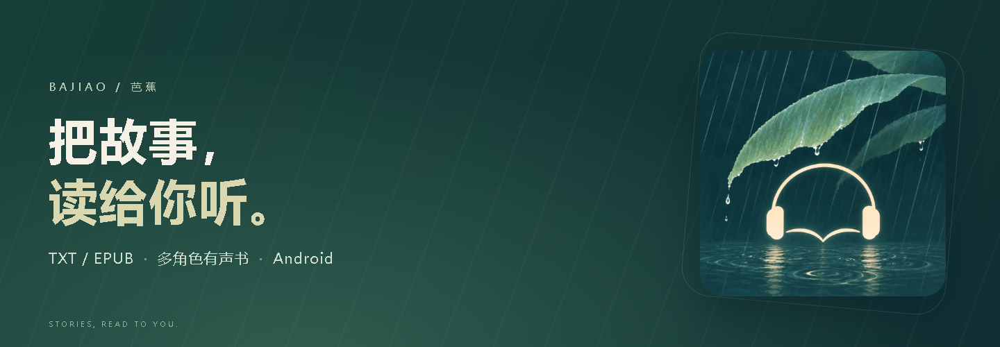
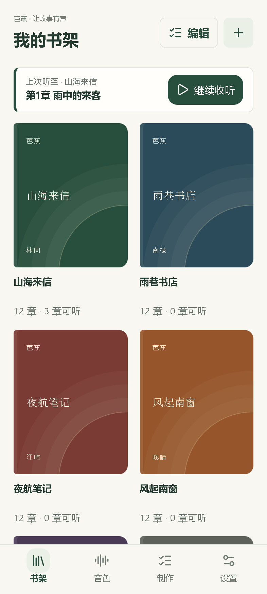
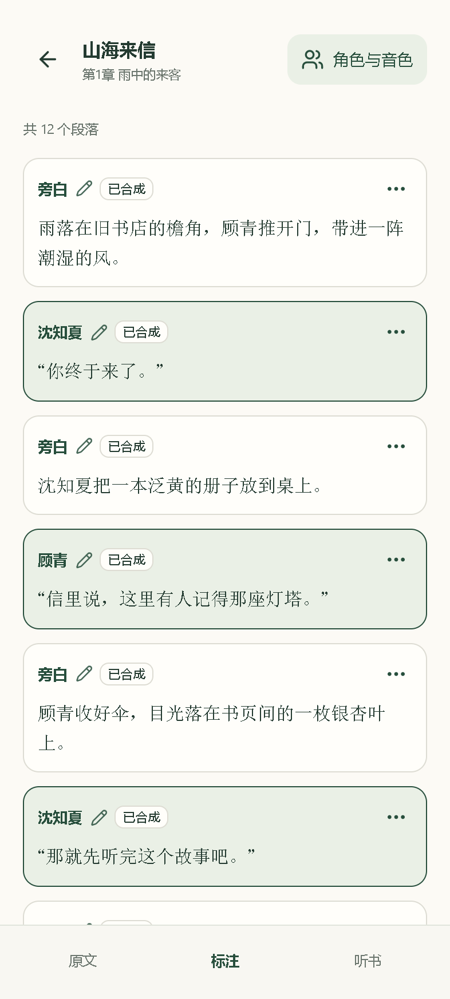
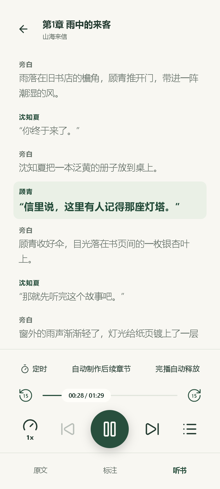
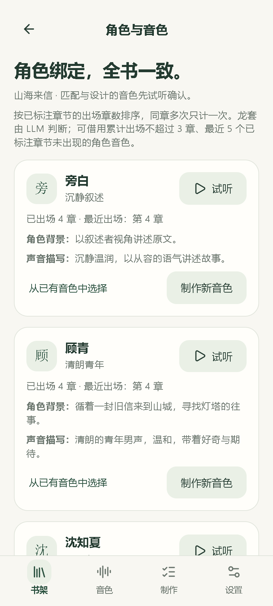
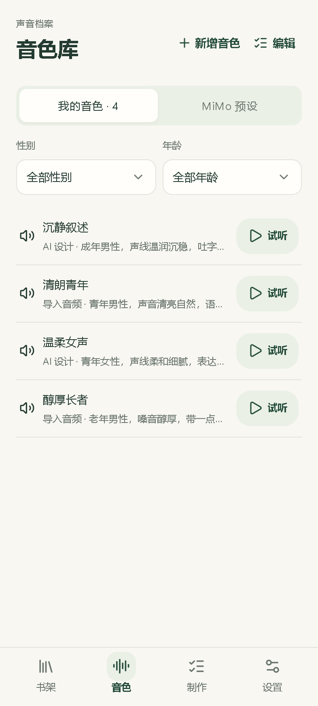
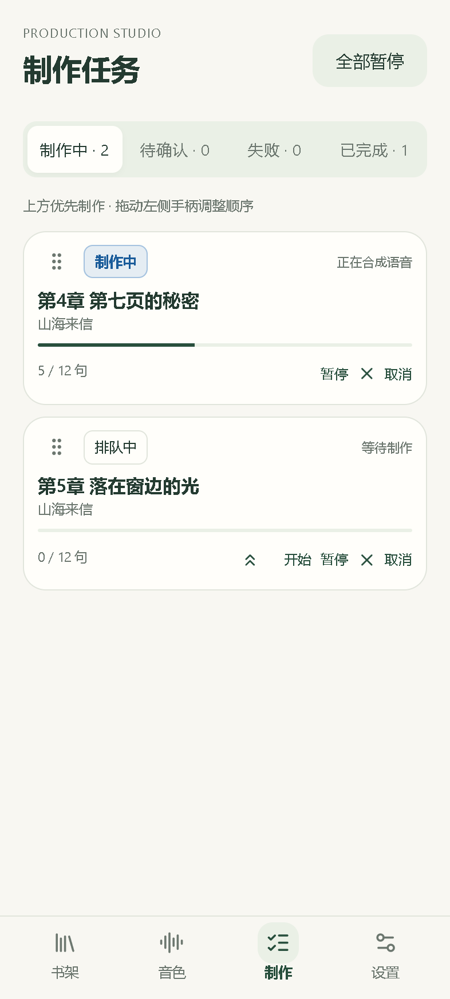

<p align="center">
  
</p>

<h1 align="center">芭蕉 · Bajiao</h1>

<p align="center">
  <strong>把喜欢的文字，做成有角色、有声音的故事。</strong><br />
  在 Android 上导入小说，识别旁白与对白，为角色选择音色，制作并收听自己的有声书。
</p>

<p align="center">
  
  
  
  
</p>

<p align="center">
  <a href="#界面预览">界面预览</a> ·
  <a href="#功能亮点">功能亮点</a> ·
  <a href="#快速开始">快速开始</a> ·
  <a href="#本地构建">本地构建</a> ·
  <a href="docs/CHANGELOG.md">更新记录</a> ·
  <a href="https://github.com/xiaguanxi/bajiao/issues">反馈问题</a>
</p>

芭蕉将有声书制作和听书放在同一个书架里。AI 帮你分清谁在说话、匹配角色声音；你可以逐句校对、试听和调整，再接着听下去。

**需要自行配置语言模型和 MiMo API Key。** 文字分析与语音合成由你选择的在线服务完成，按服务商规则计费。

## 界面预览

<p align="center">
  
  &nbsp;
  
  &nbsp;
  
</p>

<p align="center"><sub>从书架出发，校对每一句，再把故事听下去。</sub></p>

<details>
<summary><strong>更多界面：角色与音色、个人音色库、制作队列</strong></summary>
<br />
<p align="center">
  
  &nbsp;
  
  &nbsp;
  
</p>
</details>

<p align="center"><sub>截图取自当前应用界面，使用原创演示书籍与演示制作状态。</sub></p>

## 功能亮点

| 你想做的事 | 芭蕉提供的能力 |
| --- | --- |
| **把小说放进书架** | 导入 TXT / EPUB，识别章节目录，支持 UTF-8、GB18030 文本与批量选章。 |
| **让角色拥有自己的声音** | 区分旁白与对白，识别角色和别名；绑定角色音色，在全书中沿用。 |
| **建立自己的音色库** | 使用 MiMo 预设、导入 WAV / MP3 参考音频，或描述你想要的声音来设计音色。支持筛选与试听。 |
| **决定故事怎么演绎** | 选择快速或导演模式，逐句修正说话人、情绪与朗读提示词；需要时单独重做一句。 |
| **安排章节制作** | 查看进度，暂停、继续与重试，拖动调整优先级；恢复时复用已经完成的片段。 |
| **随时接着听** | 原文、标注、听书三种模式；逐句字幕、播放断点、倍速、睡眠定时、后台播放与 WAV 导出。 |

## 从文字到声音

1. **导入小说**：把 TXT 或 EPUB 加入书架，检查章节划分。
2. **识别与校对**：让语言模型标注旁白、对白和角色，需要时手动修正。
3. **选择角色声音**：使用已有音色，或导入、设计新音色；可先试听确认再采用。
4. **制作并收听**：按章制作，在已有内容就绪后开始听书，也可以导出 WAV。

## 快速开始

### 1. 准备应用

需要 **Android 8.0 / API 26 或更高版本**。从 [GitHub Releases](https://github.com/xiaguanxi/bajiao/releases) 下载 APK，按系统提示安装；也可以按[本地构建](#本地构建)自行生成。

安装后可在「设置 → 关于」手动检查更新，或开启启动时自动检查。发现新版本后，点击下载并按系统提示安装。

### 2. 配置服务

在应用的「设置」中分别设置：

| 配置项 | 用途 | 需要填写 |
| --- | --- | --- |
| **语言模型** | 理解原文、识别角色、匹配音色与生成演绎指导 | 接口协议、服务地址、模型 ID、API Key；支持 OpenAI 兼容与 Anthropic Messages 协议。 |
| **语音引擎** | 语音合成、音色设计与参考音频克隆 | MiMo API Key。 |

先测试连接或合成，再点击**保存设置**。测试会产生服务用量，测试成功后仍需保存。

### 3. 做好第一章

回到「书架」导入一本小说，选择一章开始制作。根据提示确认角色和音色；内容就绪后，进入听书页收听。

制作模式、音色分配、失败重试等选项，可以在「设置」中调整；各设置页右上角的问号提供对应帮助。

## 本地构建

准备 **JDK 17**、**Android SDK Platform 35** 和 **Build Tools 35.0.0**，配置 `JAVA_HOME` 与 `ANDROID_HOME`。

```bash
git clone https://github.com/xiaguanxi/bajiao.git
cd bajiao
```

Windows / PowerShell：

```powershell
.\gradlew.bat assembleDebug
```

macOS / Linux：

```bash
sh ./gradlew assembleDebug
```

APK 输出到 `app/build/outputs/apk/debug/app-debug.apk`。构建产物不包含 API Key，安装后在应用中配置。

完整构建、测试、目录结构与截图生成方法见[开发指南](docs/DEVELOPMENT.md)。

## 常见问题

<details>
<summary><strong>制作有声书需要联网吗？</strong></summary>

需要。文字分析与语音合成会调用配置的在线服务。书库、角色资料和已生成音频保存在设备上，章节音频可以导出为 WAV。

</details>

<details>
<summary><strong>使用过程中会产生哪些费用？</strong></summary>

语言模型和语音服务按各自的账户与计费规则产生用量。连接测试、测试合成、音色设计、克隆和重做也可能产生对应服务用量。

</details>

<details>
<summary><strong>AI 认错说话人，或某一句读得不合适怎么办？</strong></summary>

在标注页修改对应句子的说话人、情绪或朗读提示词，再单独重做这一句。替换音频失败时，会保留已有可播放的音频。

</details>

<details>
<summary><strong>为什么源码里还保留旧项目名称？</strong></summary>

显示名称统一为「芭蕉」，英文标识为 `Bajiao` / `bajiao`。安装 ID、原生组件包名与旧密钥别名继续保留，以支持覆盖升级及已有数据读取。具体说明见[工程命名与兼容](docs/DEVELOPMENT.md#工程命名与兼容)。

</details>

## 文档与参与

- [开发指南](docs/DEVELOPMENT.md)：构建、测试、工程结构与界面素材生成。
- [设置与配置说明](docs/settings-redesign.md)：配置项、保存方式与升级迁移。
- [更新记录](docs/CHANGELOG.md)：版本变化与历史验证记录。
- [反馈问题](https://github.com/xiaguanxi/bajiao/issues)：请附应用版本、Android 版本与复现步骤。

欢迎通过 Issue 交流使用体验、报告问题和提出功能建议，也欢迎提交文档修正与代码改进。
